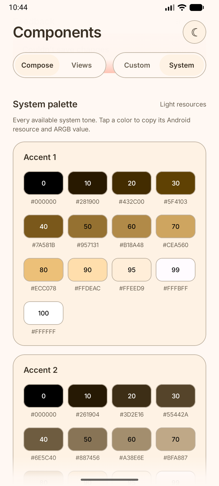

<p align="center">
  
</p>

# Android Dynamic Colors

Use Android's system colors in Compose, Views, and XML. Read named colors such as `primary` and `surface`, or individual shades from the full palette. The core library has no UI framework dependency; optional modules handle Compose state, View subscriptions, and Data Binding.

## Contents

- [Install](#install)
- [Quick start](#quick-start)
- [Compose](#compose)
- [Views and Fragments](#views-and-fragments)
- [Custom Views](#custom-views)
- [XML Data Binding](#xml-data-binding)
- [Palette tones](#palette-tones)
- [Platform behavior](#platform-behavior)
- [Screenshots](#screenshots)
- [Sample app](#sample-app)
- [Development](#development)
- [License](#license)

## Install

Choose the module for your UI:

| Your app uses | Add this artifact |
| --- | --- |
| Jetpack Compose | `dynamic-colors-compose` |
| Android Views or View Binding | `dynamic-colors-views` |
| XML Data Binding | `dynamic-colors-databinding` |
| Only color values, without UI helpers | `dynamic-colors` |

Add the dependency, with `google()` and `mavenCentral()` in your repositories:

```kotlin
implementation("io.github.lucf15:dynamic-colors-compose:0.1.0")
```

Replace the artifact name for another integration. Each UI module already includes the core. For a local build, follow the [local Maven instructions](docs/releasing.md#validate-locally).

**Android 12+ provides system colors.** On older devices, use your app's existing colors as a fallback. The modules run on API 21+, except Compose, which requires API 23+. The Compose dependency requires compile SDK 37.

## Quick start

Read a color scheme that follows the device's light/dark mode:

```kotlin
import androidx.compose.foundation.text.BasicText
import androidx.compose.runtime.Composable
import androidx.compose.ui.graphics.Color
import io.github.lucf15.dynamiccolors.compose.rememberDynamicColorSchemeOrNull

@Composable
fun Greeting() {
    val colors = rememberDynamicColorSchemeOrNull()
    BasicText(
        text = "Hello, Android",
        color = colors?.primary ?: Color(0xFF2563EB),
    )
}
```

The following sections cover whole-app themes, lifecycle ownership, and XML layouts.

## Compose

Wrap the relevant subtree in `DynamicColorsTheme`. It remembers the system colors, selects light or dark roles, and exposes an immutable `DynamicColorScheme` containing Compose `Color` values.

```kotlin
import androidx.compose.foundation.background
import androidx.compose.foundation.isSystemInDarkTheme
import androidx.compose.foundation.layout.Box
import androidx.compose.foundation.text.BasicText
import androidx.compose.runtime.Composable
import androidx.compose.ui.Modifier
import io.github.lucf15.dynamiccolors.compose.DynamicColorScheme
import io.github.lucf15.dynamiccolors.compose.DynamicColorsTheme

@Composable
fun AppTheme(
    lightFallback: DynamicColorScheme,
    darkFallback: DynamicColorScheme,
    useSystemColors: Boolean = true,
    content: @Composable () -> Unit,
) {
    val dark = isSystemInDarkTheme()
    DynamicColorsTheme(
        fallback = if (dark) darkFallback else lightFallback,
        darkTheme = dark,
        useDynamicColors = useSystemColors,
        content = content,
    )
}

@Composable
fun StatusCard() {
    val colors = DynamicColorsTheme.colorScheme
    Box(Modifier.background(colors.primaryContainer)) {
        BasicText("Ready", color = colors.onPrimaryContainer)
    }
}
```

Create your fallback once with `DynamicColorScheme { role -> /* your Compose Color */ }`, or convert an existing core `ColorRoles` with `toComposeColorScheme()`. The [sample mapping](sample/src/main/kotlin/io/github/lucf15/dynamiccolors/sample/theme/ComposeColors.kt) shows a complete app-owned palette. Custom schemes retain their Compose color spaces.

The provider refreshes on resource/configuration changes, supports nested themes, and uses your fallback when system colors are unavailable or disabled. It does not install `MaterialTheme`. Access outside a provider reports a setup error.

For an existing theme implementation, use `rememberDynamicColorScheme(fallback, darkTheme)` or `rememberDynamicColorSchemeOrNull(darkTheme)`. `rememberDynamicColorsOrNull()` exposes both core light/dark sets when needed.

For previews, wrap your theme with `DynamicColorsPreview { ... }`. Pass `colors = null, palette = null` to preview unavailable system colors. Fixtures apply only in inspection mode; they never replace runtime resources.

## Views and Fragments

Use AndroidX Fragment and Lifecycle's `lifecycle-runtime-ktx` dependency. `collectDynamicColorRoles` selects the View's mode and owns its subscription until cancellation:

```kotlin
import android.graphics.Color
import android.os.Bundle
import android.view.View
import android.widget.TextView
import androidx.fragment.app.Fragment
import androidx.lifecycle.Lifecycle
import androidx.lifecycle.lifecycleScope
import androidx.lifecycle.repeatOnLifecycle
import io.github.lucf15.dynamiccolors.views.collectDynamicColorRoles
import kotlinx.coroutines.launch

class ColorsFragment : Fragment(R.layout.fragment_colors) {
    override fun onViewCreated(view: View, savedInstanceState: Bundle?) {
        super.onViewCreated(view, savedInstanceState)
        val title = view.findViewById<TextView>(R.id.title)
        viewLifecycleOwner.lifecycleScope.launch {
            viewLifecycleOwner.repeatOnLifecycle(Lifecycle.State.STARTED) {
                view.collectDynamicColorRoles { colors ->
                    view.setBackgroundColor(colors?.surface ?: Color.WHITE)
                    title.setTextColor(colors?.onSurface ?: Color.BLACK)
                }
            }
        }
    }
}
```

A minimal `res/layout/fragment_colors.xml`:

```xml
<FrameLayout xmlns:android="http://schemas.android.com/apk/res/android"
    android:layout_width="match_parent"
    android:layout_height="match_parent">
    <TextView
        android:id="@+id/title"
        android:layout_width="wrap_content"
        android:layout_height="wrap_content"
        android:text="@string/app_name" />
</FrameLayout>
```

The example uses a simple white/black fallback; use your own mode-aware design palette in production. Pass `darkTheme = true` or `false` to override automatic mode selection.

Stopping the View lifecycle cancels collection and closes the subscription; restarting creates a fresh one. Use **`viewLifecycleOwner`**, because a Fragment can outlive its layout. With View Binding, capture the current binding locally in `onViewCreated()` and clear your binding field in `onDestroyView()` as usual. No subscription handle is needed.

`collectDynamicColors` provides both modes; `collectDynamicPalette` provides raw ramps. All collectors handle registration, callbacks, and cleanup on `Dispatchers.Main.immediate`, even when called from another dispatcher. Callbacks may suspend and run sequentially; slow consumers retain only the latest pending update. Callback failures propagate after cleanup. Collect multiple streams in separate child `launch` blocks. See [Android's lifecycle guidance](https://developer.android.com/topic/libraries/architecture/views/coroutines-views).

## Custom Views

For a reusable custom View, attachment is a natural ownership boundary:

```kotlin
package com.example.app

import android.content.Context
import android.util.AttributeSet
import android.widget.TextView
import io.github.lucf15.dynamiccolors.views.observeDynamicColorRoles

class DynamicLabel @JvmOverloads constructor(
    context: Context,
    attrs: AttributeSet? = null,
    defStyleAttr: Int = android.R.attr.textViewStyle,
) : TextView(context, attrs, defStyleAttr) {
    private var subscription: AutoCloseable? = null
    private val fallback = textColors

    override fun onAttachedToWindow() {
        super.onAttachedToWindow()
        subscription = observeDynamicColorRoles { colors ->
            if (colors == null) setTextColor(fallback)
            else setTextColor(colors.onSurface)
        }
    }

    override fun onDetachedFromWindow() {
        subscription?.close()
        subscription = null
        super.onDetachedFromWindow()
    }
}
```

Inflate it using `<com.example.app.DynamicLabel ... />` in XML. For Canvas components, update `Paint` colors and call `invalidate()` in the callback. `observeDynamicColors` and `observeDynamicPalette` expose both modes or raw ramps when required.

Observe and close on the main thread. Subscriptions share **one attachment listener per View**, one pending refresh per View, and one snapshot read per kind per refresh. Attached Views share one application configuration callback. Handles close independently; closing the last removes the View listener. Detached observers pause and can resume. Permanently closing a handle releases its View/callback references. Repeated calls still represent separate subscriptions, so register once per owner rather than during each render.

## XML Data Binding

Add `dynamic-colors-databinding` and enable `android.buildFeatures.dataBinding = true`. Kotlin Data Binding needs annotation processing: this project uses `com.android.legacy-kapt` with AGP 9's built-in Kotlin; older Kotlin Android projects use their usual kapt setup.

```xml
<layout xmlns:android="http://schemas.android.com/apk/res/android"
    xmlns:app="http://schemas.android.com/apk/res-auto">
    <data>
        <import type="io.github.lucf15.dynamiccolors.ColorRole" />
    </data>
    <TextView
        android:layout_width="match_parent"
        android:layout_height="wrap_content"
        android:background="#F5F5F7"
        android:text="@string/app_name"
        android:textColor="#1B1B1F"
        app:dynamicBackgroundTint="@{ColorRole.Surface}"
        app:dynamicTextColor="@{ColorRole.OnSurface}" />
</layout>
```

No color observer or color ViewModel is required. The [sample XML](sample/src/main/res/layout/dynamic_color_label.xml) is compiled against the separately packaged adapters.

| Attribute | Target | Value |
| --- | --- | --- |
| `dynamicTextColor` | `TextView` and subclasses | Nullable `ColorRole` |
| `dynamicBackgroundTint` | Any View with a background | Nullable `ColorRole` |
| `dynamicImageTint` | `ImageView` and subclasses | Nullable `ColorRole` |
| `dynamicDarkTheme` | Each affected View | Nullable `Boolean`; null follows configuration |
| `dynamicTextColorFallback` | `TextView` | Optional ARGB color |
| `dynamicBackgroundTintFallback` | `View` | Optional ARGB color |
| `dynamicImageTintFallback` | `ImageView` | Optional ARGB color |

A fallback can reference an app resource: `app:dynamicTextColorFallback="@{@color/my_text_fallback}"`. Transparent zero is valid. Without a fallback, unavailable system colors preserve the original color/tint state list. A dynamic role applies a single color to all widget states; setting its expression to `null` restores the original state list, including disabled/pressed colors. Tint adapters preserve existing drawables and shapes.

Repeated binding updates reuse one subscription per View. Detach unregisters configuration observation; reattachment refreshes it. Removing the last role closes the subscription. `dynamicDarkTheme` applies to that View, not its descendants. Use `binding.lifecycleOwner = viewLifecycleOwner` when your expressions read LiveData; color observation itself follows attachment. `binding.unbind()` stops expression updates but does not reset an attached View's dynamic colors.

## Palette tones

The core has no UI dependency:

```kotlin
import io.github.lucf15.dynamiccolors.PaletteFamily
import io.github.lucf15.dynamiccolors.Tone
import io.github.lucf15.dynamiccolors.dynamicPaletteOrNull

val palette = dynamicPaletteOrNull(context)
val accentArgb: Int? = palette?.accent1?.get(Tone.T40)
val errorArgb: Int? = palette?.get(PaletteFamily.Error)?.get(Tone.T40)
```

| Family | Android resource prefix | Available from |
| --- | --- | --- |
| Accent 1, 2, 3 | `system_accent1_`, `system_accent2_`, `system_accent3_` | API 31 |
| Neutral 1, 2 | `system_neutral1_`, `system_neutral2_` | API 31 |
| Error | `system_error_` | API 35 |

Every ramp contains **13 tones**: `T0`, `T10`, `T20`, `T30`, `T40`, `T50`, `T60`, `T70`, `T80`, `T90`, `T95`, `T99`, `T100`. There are **65 raw colors on API 31–34** and **78 on API 35+**. `error` is null before API 35; missing tones/families are not synthesized.

Tone numbers increase with lightness. Android resource suffixes run in the opposite direction: suffix = `(100 - tone) × 10`, so `Tone.T40` corresponds to `_600`. The [sample explorer](sample/README.md) shows every available swatch and copies its resource name and ARGB value when tapped.

In Compose, use `rememberDynamicPaletteOrNull()` and `palette.color(PaletteFamily.Accent1, Tone.T40)` for a native `Color?`. Pass `darkTheme = true/false` when previewing a specific resource mode. Raw ramps follow the requested configuration and can differ by mode on Android 17. In Views, use `collectDynamicPalette` or `observeDynamicPalette` for updates.

## Platform behavior

`dynamicColorsOrNull(context)` returns complete `light` and `dark` sets, each with **48 semantic roles**. `ColorRoles` has named ARGB properties and indexed access with `ColorRole`; the Compose `DynamicColorScheme` exposes the same roles as native `Color` properties.

| Android version | Semantic role source |
| --- | --- |
| Below API 31 | Unavailable; readers return null |
| API 31–33 | Real palette stops; nearest available stops for missing surface tones, baseline error colors |
| API 34–36 | Platform semantic resources, with inverse/tint aliases and black scrim where dedicated resources are unavailable |
| API 37+ | Dedicated inverse, tint, and scrim resources; light/dark contexts resolved independently |

These are platform values, not a promise of identical output to every Material 3 version. See the [source review](docs/review.md) and [platform behavior](docs/platform-behavior.md). Core snapshots retain no Context. Direct readers perform fresh reads; framework adapters own refresh behavior.

## Screenshots

| Palette | Light | Dark |
| --- | :---: | :---: |
| Custom · blue |  |  |
| System · violet `#6750A4` |  |  |
| System · teal `#006A6A` |  |  |
| System · terracotta `#A35139` |  |  |

The Custom palette is defined by the sample. System examples use three emulator seeds with Tonal Spot; the library reads the resulting Android colors.

<details>
<summary>See the palette explorer</summary>



</details>

## Sample app

Open the project in Android Studio and run **sample**. Switch between Compose and Views, compare Custom and System colors, and try both light and dark mode.

The sample includes buttons, text input, switches, cards, dialogs, and the palette explorer. [Source layout and build instructions →](sample/README.md)

## Development

Use JDK 17 and Android SDK 37. Run `./gradlew verify` for formatting, library tests, lint, release builds, and sample compilation.

[Contributing](CONTRIBUTING.md) · [Platform behavior](docs/platform-behavior.md) · [Source validation](docs/review.md) · [Maven Central releases](docs/releasing.md)

## License

[Apache-2.0](LICENSE). The sample's Inter font uses the [SIL Open Font License](sample/INTER-LICENSE.txt).
