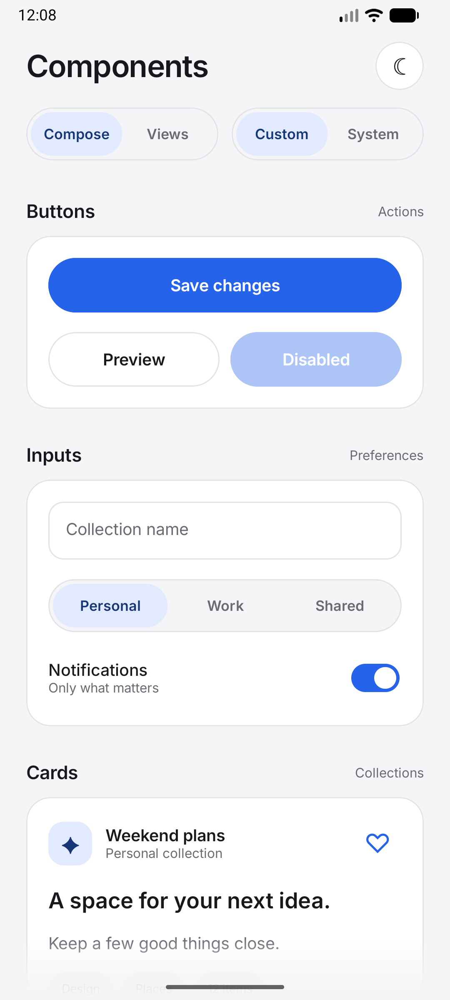
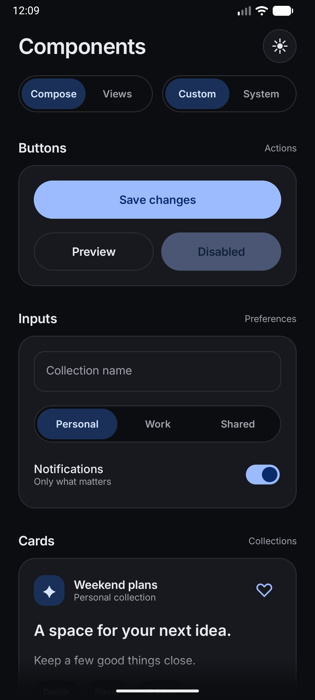
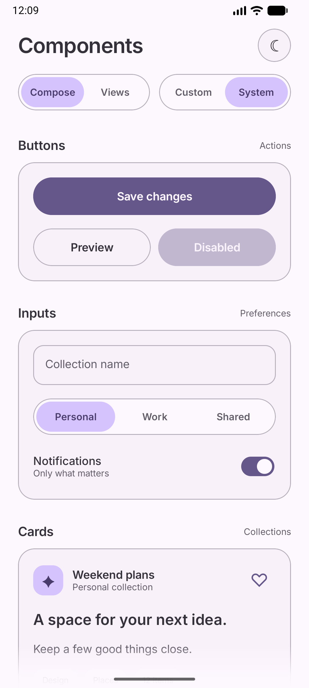
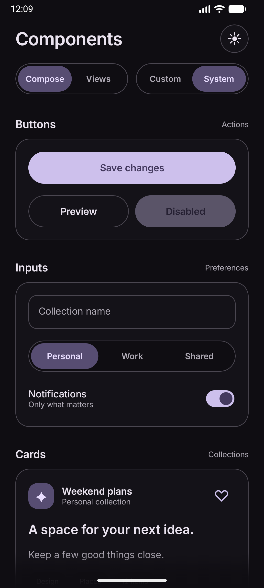
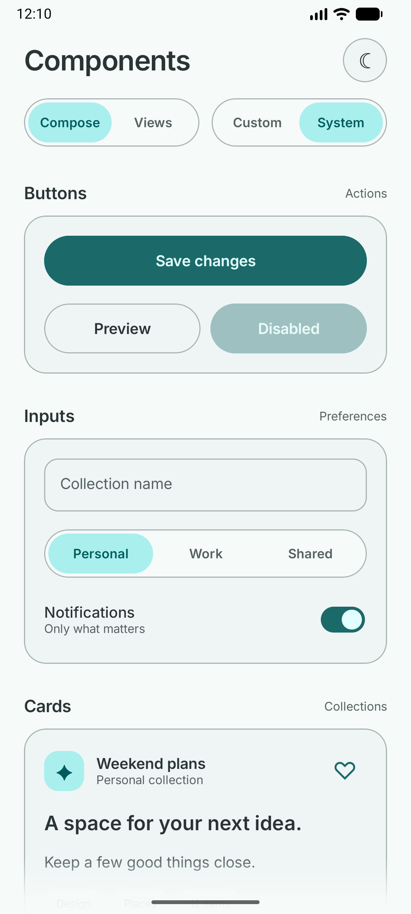
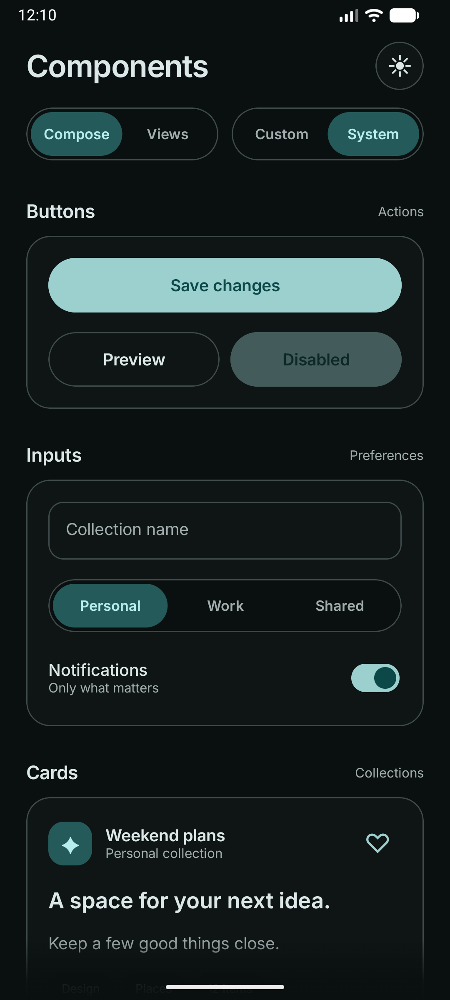
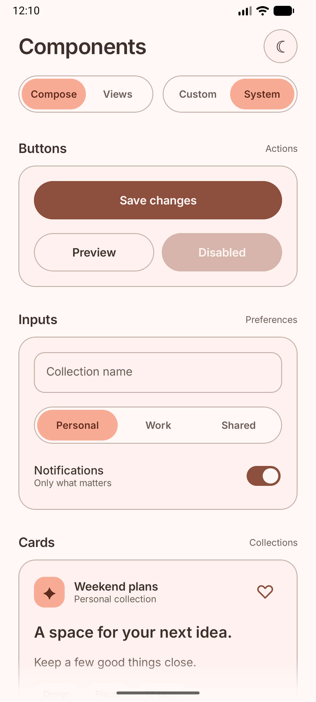
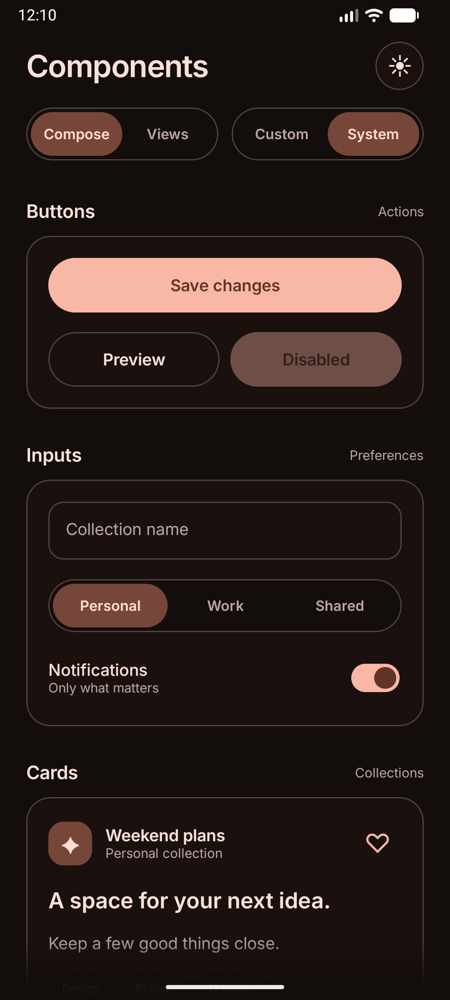

# Component gallery

A component gallery and system palette explorer with Compose and custom Android View renderers.

## Sample screenshots

| Palette | Light | Dark |
| --- | :---: | :---: |
| Custom · blue |  |  |
| System · violet `#6750A4` |  |  |
| System · teal `#006A6A` |  |  |
| System · terracotta `#A35139` |  |  |

The Custom palette is defined by the sample. System examples use three emulator seeds with Tonal Spot; the library reads the resulting Android colors.

The header switches between **Compose / Views** and **Custom / System** colors. The sun/moon button previews either theme. The full-window list scrolls beneath soft top and bottom fades. IME insets add bottom **content padding** to the list, rather than padding the root or shrinking the viewport. Together with `adjustNothing`, this leaves actual content behind translucent keyboards while providing enough scroll range to move items above them. The bottom fade stays at the screen edge.

Below the components, **System palette** shows all 13 tones in each available family: Accent 1–3, Neutral 1–2, and Error on API 35+. Swatches show tone and hex values; tapping copies the Android resource name and full ARGB value. The explorer always reads system resources, independently of the Custom / System theme switch, and follows the selected light/dark mode. On API < 31 it explains that no system palette is available. Each ramp is a separate lazy-list item with Compose and native View renderers.

Both frameworks render the same `ShowcaseState`: text, category, notification switch, saved state, favorite, and dismissed feedback survive renderer changes. The Views tab uses custom `StudioButtonView`, `StudioCardView`, `StudioFieldView`, `StudioSegmentsView`, and `StudioSwitchView`; it does not substitute standard radio buttons or checkboxes for the Compose designs.

Press feedback uses a restrained 1.5% compression. Selection indicators and switch thumbs use matching damped springs (damping 0.9, stiffness 600). Palette changes settle over 260 ms. Animations remain interruptible and honor disabled system animations.

The source is organized by responsibility:

- `theme/`: shared app defaults plus a complete Compose-native fallback mapping in `ComposeColors.kt`.
- `model/ShowcaseState.kt`: shared interaction state.
- `compose/ColorStudio.kt`: saved state and the library theme provider; `StudioContent.kt`: gallery layout; `sections/` contains the four restartable gallery sections and `components/` contains reusable controls.
- `views/`: native gallery lifecycle, section builders, and dialog; `components/` contains custom controls and layout/motion helpers.

Compose sections receive only their own values and callbacks. Gallery callbacks keep their identity while reading the latest shared state. The compiler reports mark the header, sections, and controls as restartable and skippable; this is a structural check, not a frame-time benchmark. Generate the reports with `./gradlew :sample:compileDebugKotlin -PcomposeReports` and inspect `sample/build/compose-reports/`.

The Compose renderer uses `DynamicColorsTheme.colorScheme`; its component palette and animations retain native `Color` values. The palette explorer uses `rememberDynamicPaletteOrNull(darkTheme)` without constructing its own configuration contexts. The Views renderer uses `observeDynamicColorRoles(darkTheme)` only while attached and system colors are selected; it closes the subscription on detach/disposal and recreates it when mode changes. Text centering and weighted rows use the same pixel-rounding rules as Compose, including fractional display densities.

Run the `sample` configuration. The app has no Material 3 dependency. Android Studio light/dark previews are included. Inter is distributed under the SIL Open Font License: [INTER-LICENSE.txt](INTER-LICENSE.txt), also bundled in the APK assets.

## XML Data Binding example

`res/layout/dynamic_color_label.xml` is a compiled consumer example of the optional Data Binding module. It binds semantic roles directly to text and background tint. The component gallery remains Compose/custom Views; the XML example verifies the separately packaged adapters without changing the showcase navigation.
